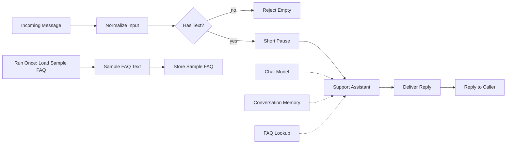

# Example 01 — Support Agent with Simple RAG

> Didactic example, not the production implementation. All names, prompts and data are fictional.

## Goal

Show the basic shape of a conversational support agent in n8n: receive a message over HTTP, clean it up, wait briefly, let an AI agent answer using a small knowledge base and short-term memory, and send the reply back.

File: [`01-support-agent-example.json`](01-support-agent-example.json)

## Flow

1. **Incoming Message** — a generic HTTP webhook receives `message`, `sessionId` and an optional `callbackUrl`.
2. **Normalize Input** — trims the text and fills defaults.
3. **Has Text?** — empty messages are rejected with a `400` response.
4. **Short Pause** — a brief wait, the simplest way to illustrate message grouping.
5. **Support Assistant** — an AI Agent with a short fictional system prompt.
   - **Chat Model**: OpenAI chat model.
   - **Conversation Memory**: window buffer memory keyed by `sessionId`.
   - **FAQ Lookup**: in-memory vector store used as a tool (simple RAG).
6. **Deliver Reply** — HTTP request posting the answer to the callback URL.
7. **Reply to Caller** — responds to the original webhook call with the answer.

A separate manual branch (**Run Once: Load Sample FAQ**) loads a few fictional FAQ sentences into the in-memory vector store, using the same embeddings node.

## How to import

1. In n8n, open **Workflows** → **Import from file**.
2. Select `01-support-agent-example.json`.
3. The workflow is imported inactive; keep it that way until it is configured.

## What you need to configure

- **Your own OpenAI API key**: create a credential and select it on the *Chat Model* and *Embeddings* nodes. No credentials are included in the file.
- **Webhook URL**: use the test URL shown on the *Incoming Message* node and send a `POST` with JSON such as `{"message": "How long does shipping take?", "sessionId": "demo-1"}`.
- **Callback URL** (optional): replace the placeholder in *Deliver Reply* or pass `callbackUrl` in the request.
- Run the manual branch once so the vector store has content. The in-memory store is cleared when n8n restarts.

## Limitations

- Didactic example, not the production implementation.
- The in-memory vector store is not persistent and not meant for real workloads.
- No authentication on the webhook, no error handling, no rate limiting.
- The short wait only illustrates the idea of grouping messages; it does not implement real batching.
