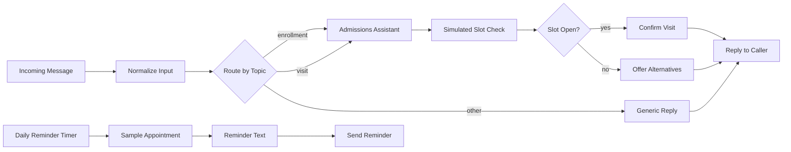

# Example 02 — Enrollment and Visit Scheduling

> Didactic example, not the production implementation. All names, prompts and data are fictional.

## Goal

Show how to route incoming messages by topic, let an AI agent collect enrollment details with simple questions, run a simulated availability check, confirm or offer alternatives, and send scheduled reminders.

File: [`02-enrollment-scheduling-example.json`](02-enrollment-scheduling-example.json)

## Flow

1. **Incoming Message** — generic HTTP webhook receiving `message`, `sessionId` and an optional `requestedSlot`.
2. **Normalize Input** — trims text and fills defaults.
3. **Route by Topic** — a Switch node with three outputs: enrollment, visit, and everything else.
4. **Admissions Assistant** — AI Agent with a short fictional prompt for a fictional school, with OpenAI chat model and window buffer memory.
5. **Simulated Slot Check** — a Set node holding a hard-coded list of open slots (sample data only).
6. **Slot Open?** — an IF node compares the requested slot with the sample list.
7. **Confirm Visit** / **Offer Alternatives** — builds the final text.
8. **Reply to Caller** — responds to the webhook call.

Reminder branch: **Daily Reminder Timer** (Schedule Trigger) → **Sample Appointment** → **Reminder Text** → **Send Reminder** (HTTP request to a placeholder URL).

## How to import

1. In n8n, open **Workflows** → **Import from file**.
2. Select `02-enrollment-scheduling-example.json`.
3. The workflow is imported inactive.

## What you need to configure

- **Your own OpenAI API key**: create a credential and select it on the *Chat Model* node. No credentials are included.
- **Webhook URL**: use the test URL of *Incoming Message* and `POST` JSON such as `{"message": "I want to enroll my child", "sessionId": "demo-1", "requestedSlot": "Tuesday 14:00"}`.
- **Reminder URL**: replace the placeholder in *Sample Appointment* before enabling the schedule.

## Limitations

- Didactic example, not the production implementation.
- Availability is simulated with hard-coded sample data; there is no real calendar or database.
- Routing uses plain keyword matching.
- No authentication, error handling or retries.
